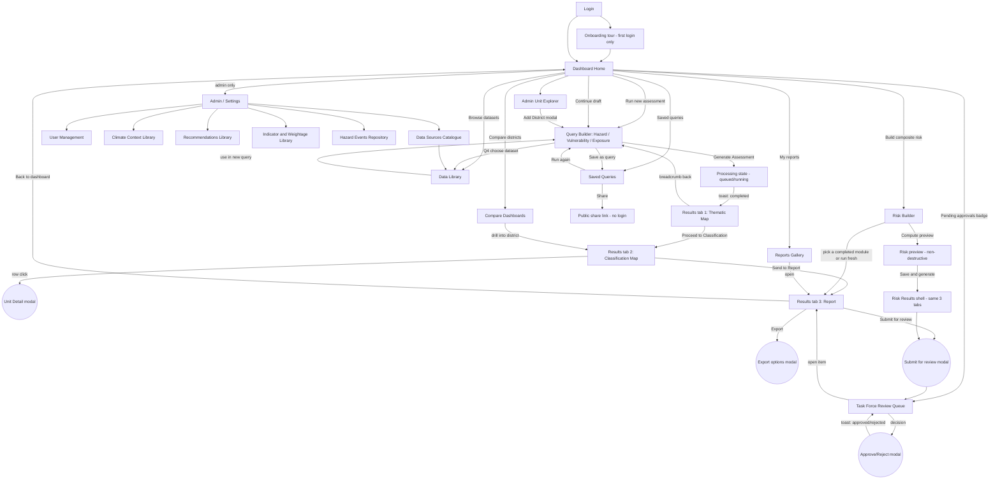

# HVRA Digital Platform — Rework & Completion Spec

**Purpose of this document:** This is a standalone build spec for reworking an existing Hazard–Vulnerability–Risk Assessment (HVRA) platform. The prior implementation was rejected by the project manager because **pages existed in isolation — no clear navigation between them, no consistent entry/exit points, no thread connecting a query to its results to its report to the next module.** This document fixes that: every page below states exactly what links into it and exactly what it links out to. Treat the "Enters from" / "Exits to" columns as mandatory wiring, not documentation.

This spec assumes a continuation of an existing codebase (not a greenfield build) — see §11 for the current stack.

---

## 1. What the client requires (source spec summary)

A national, web-based tool letting a district/state disaster management officer — no GIS/stats training — generate a defensible hazard, vulnerability, exposure, or composite risk assessment by answering a structured **query**. Every query produces **three outputs**:

1. **Thematic map** — raw hazard layer (polygon/point/line) over admin boundaries + historical events
2. **Administrative classification map** — each unit (village/block/district) shaded NH (No Hazard) / LH (Low) / MH (Medium) / HH (High), always relative to neighbouring units
3. **Chapter-wise report** — auto-compiled narrative + tables + maps, exportable to DOCX/PDF

Same pattern repeats for Hazard → Vulnerability → Exposure, then a fourth module combines them: **Risk = Hazard × Vulnerability × Exposure**.

**Governance model (critical, drives page structure):** each domain department assesses its own layer "at the source" (Water Resources/IMD/GSI → Hazard; Health/Education/Census → Vulnerability; Revenue/ULB/PWD → Exposure) and submits it directly. Composite risk is auto-generated. A state/district **Task Force**, formally constituted by government order, must review and endorse before a report is finalized. This is why a **Review Queue page** is not optional.

Four architecture layers: **Data → Processing/Assessment Engine → Query/Application → Output/Presentation.**

---

## 2. Current build — condensed gap assessment

Already correctly implemented (keep, don't rebuild): scoring engine (weightage bands, NH/LH/MH/HH classification, relative-to-neighbours logic), Risk engine (H×V×E as weighted geometric mean), territory-scoped RBAC, Task Force approval state machine on the data model, Historical Events/Climate Context/Recommendations library models, the Screen-1 query-builder wizard pattern.

**The specific defect the PM flagged — no page-to-page connection — breaks down into:**

| Symptom | Root cause |
|---|---|
| Thematic map and classification map feel like one confusing screen, not two connected steps | Both were merged into a single toggle-everything map component instead of two screens with an explicit "Proceed to Classification →" handoff |
| Finishing a query doesn't clearly lead anywhere | No shared "Results shell" with tabs/breadcrumb carrying the assessment ID through Map → Classification → Report |
| Modules feel like separate silos (Hazard page, Vulnerability page, Risk page don't reference each other) | No dashboard surfacing "you have a completed Hazard assessment — link it into Risk," no cross-links from Data Library into the query builder and back |
| Submitting for review goes nowhere visible | No Review Queue page for a Task Force reviewer to land on and act |
| Users land on a page with no way back except the browser back button | No consistent breadcrumb / "where am I in the journey" indicator on any page |

**The fix is Section 4 (navigation model) + Section 6 (page-by-page entry/exit table) below — apply these as hard requirements, not suggestions.**

---

## 3. Full site map with connections

**Rule for the build agent:** every node in this diagram must exist as a real link/button in the UI, not just a route. If a page is reachable only by typing a URL, that's the exact defect this rework fixes.

---

## 4. Navigation model (the connective tissue — applies to every page)

Every authenticated page uses one persistent shell:

- **Top bar** (always visible): logo/home link → Dashboard · role badge · state/district context switcher · notification bell (opens Notification Center, full history) · help menu · profile menu
- **Left sidebar** (role-filtered, always visible): Dashboard Home, Hazard Assessment, Vulnerability Assessment, Exposure Assessment, Risk Assessment, Data Library, Saved Queries, Reports, Task Force Review (badge with pending count, role-gated), Compare Dashboards, Admin Unit Explorer, Admin/Settings (role-gated)
- **Breadcrumb bar** under the top bar on every non-dashboard page, e.g. `Dashboard > Hazard Assessment > Barpeta District > Classification Map` — every breadcrumb segment is a clickable link back
- **Journey indicator** on the 3-tab Results shell: `Map → Classification → Report`, current tab highlighted, all three always clickable (not gated to forward-only) once an assessment has completed
- **Global toast stack**, bottom-right, for every async action (see §7)
- **`Ctrl/Cmd+K` command palette**: jump to any district, assessment, or report by name — the escape hatch for deep navigation

**Hard rule:** no page may be a dead end. Every page ends in at least one primary CTA (forward action) and one way back (breadcrumb or "Back to Dashboard" link) — this is the literal fix for the PM's complaint.

---

## 5. End-to-end journeys (proving the connections work)

**A — District officer runs a Hazard assessment, end to end**
Login → Dashboard Home (sees "Run new assessment" CTA) → Query Builder (module=HAZARD, answers Q1–Q4, live preview updates) → clicks Generate → Processing state (toast on completion) → Results/Map tab (reviews raw hazard layer + events) → clicks "Proceed to Classification" → Results/Classification tab (reviews choropleth + attribute table, clicks a block for Unit Detail modal) → clicks "Send to Report" → Results/Report tab (reviews chapters, exports DOCX) → clicks "Submit for review" → Submit modal confirms → toast "Submitted for review" → lands back on Dashboard Home, which now shows the assessment as "Pending review."

**B — State reviewer processes Task Force approvals**
Login → Dashboard Home (sees "3 pending approvals" badge) → clicks through to Review Queue → filters by district → opens an item (lands on that assessment's Report tab, in context) → reviews, adds comment → Approve/Reject modal → toast → returns to Review Queue with the item removed from the pending list.

**C — Assembling Composite Risk from three departments' work**
Dashboard Home → Risk Builder → picks a completed Hazard assessment (link, not re-run), a completed Vulnerability assessment, a completed Exposure assessment → sets formula + weight sliders → "Compute preview" (non-destructive) → adjusts weights, re-previews → "Save & generate" → Risk Results shell (same Map/Classification/Report tabs as any module) → Submit for review → Review Queue.

**D — Platform admin curates a library entry that then appears in a report**
Admin/Settings → Recommendations Library → "Add entry" modal (hazard type, classification, text, priority) → saves → toast → next time any officer's report reaches the Recommendations chapter for that hazard+class, the entry appears automatically — no manual step connects these, which is the intended design (per spec §4.8/4.9), but the admin UI must make this cause-and-effect visible (e.g. "Used in 4 reports" counter on the library table row) so it doesn't feel disconnected either.

---

## 6. Page-by-page spec with explicit entry/exit wiring

### Auth & onboarding

| Page (route) | Enters from | Exits to |
|---|---|---|
| Login (`/login`) | App entry, session expiry redirect | Dashboard Home (on success), Register, Forgot Password |
| Register (`/register`) | Login page link | Login (after success, or if role requires admin approval: a "pending approval" notice) |
| Forgot Password (`/forgot-password`) | Login page link | Login (after reset) |
| Onboarding (`/onboarding`, first login only) | Immediately after first successful login | Dashboard Home |

### Core

| Page (route) | Enters from | Exits to |
|---|---|---|
| **Dashboard Home** (`/dashboard`) | Login, top-bar logo from any page, breadcrumb root | Query Builder, Risk Builder, Data Library, Saved Queries, Reports, Review Queue, Compare Dashboards, Admin Unit Explorer, Admin/Settings — role-dependent CTAs (see §5) |
| **Query Builder** (`/assessments/new?module=…`) | Dashboard "Run new assessment", sidebar module links, Saved Queries "Run again", Admin Unit Explorer "Add district" (returns here) | Data Library (Q4 dataset link), Processing state (on Generate), Save-as-Query modal → Saved Queries |
| **Processing state** (`/assessments/:id/processing`) | Query Builder submit | Results/Map tab (auto-redirect on completion + toast) |
| **Results — Map** (`/assessments/:id/map`) | Processing completion, Reports Gallery, Dashboard "continue draft" | Results/Classification (primary CTA), Query Builder (breadcrumb back) |
| **Results — Classification** (`/assessments/:id/classification`) | Results/Map "Proceed", journey-indicator tab click, Compare Dashboards drill-in | Unit Detail modal, Results/Report ("Send to Report") |
| **Results — Report** (`/assessments/:id/report`) | Results/Classification "Send to Report", journey-indicator tab click, Reports Gallery, Review Queue item open | Export modal, Submit-for-review modal → Review Queue, "Back to Dashboard" |
| **Risk Builder** (`/risk-assessments/new`) | Dashboard "Build composite risk", sidebar | Risk preview → Risk Results shell (same tab pattern as above) |
| **Data Library** (`/data-library`) | Query Builder Q4 link, sidebar, Admin "Data Sources" | Query Builder ("use in new query"), dataset metadata modal |
| **Saved Queries** (`/saved-queries`) | Dashboard, sidebar, Query Builder "Save as Query" | Query Builder ("Run again," pre-filled), Share-link modal |
| **Reports Gallery** (`/reports`) | Dashboard, sidebar | Results/Report tab for the selected item |
| **Task Force Review Queue** (`/review-queue`, role-gated) | Dashboard pending-approvals badge, sidebar | Results/Report tab (open item, in context), Approve/Reject modal |
| **Admin Unit Explorer** (`/admin-units`) | Dashboard, sidebar | Add-District modal → returns to whichever page opened it (Query Builder or here) |
| **Compare Dashboards** (`/dashboard/compare`) | Dashboard, sidebar | Results/Classification tab (drill into a specific district) |

### Admin / settings (role-gated)

| Page (route) | Enters from | Exits to |
|---|---|---|
| Admin home (`/admin`) | Dashboard, sidebar | Users, Climate Context Library, Recommendations Library, Indicator & Weightage Library, Hazard Events Repository, Data Sources, Audit Log |
| User Management | Admin home | Invite/Create User modal, Assign Territory modal |
| Climate Context Library | Admin home | Add/Edit entry modal |
| Recommendations Library | Admin home | Add/Edit entry modal |
| Indicator & Weightage Library | Admin home | Add/Edit indicator + weightage-rule modal |
| Hazard Events Repository | Admin home | Add event modal, bulk import |
| Data Sources Catalogue | Admin home, Data Library | Data Library (published entries appear there) |
| Audit Log | Admin home | Deep-links into the specific assessment/user affected |

### Utility

| Page (route) | Enters from | Exits to |
|---|---|---|
| Profile (`/profile`) | Top-bar profile menu (any page) | back to previous page |
| Notification Center (`/notifications`) | Top-bar bell (any page) | deep-links into the specific item each notification refers to |
| Help (`/help`) | Top-bar help menu (any page) | back to previous page |
| 403 / 404 / 500 | Any broken/unauthorized route | Dashboard Home |

---

## 7. Modals & toasts (full inventory)

**Modals:** Add District · Upload Dataset (multi-step: select → validate → review warnings → confirm) · Save Query As · Share Saved Query (copy link) · Unit/Block Detail · Dataset/Layer Metadata · Submit-for-Review confirmation · Task Force Review Decision (approve/reject + comment) · Confirm Delete (generic, reused) · Invite/Create User · Assign Territory · Add/Edit Climate Context entry · Add/Edit Recommendation · Add/Edit Indicator & Weightage Rule · Export Options · Unsaved-changes-on-leave · Session-expiring re-auth · First-run onboarding tour

**Toasts** (success/error/info; every one also logs to Notification Center): dataset uploaded & validated / validation failed · assessment queued → processing → completed/failed · query saved · share-link copied · report exported · map exported · submitted for review · approved / rejected · district added · user created/updated · permission denied (global 403 handler) · offline/network error · territory-restriction notice

---

## 8. Design system & accessibility

- Baseline: **GIGW 3.0 / WCAG 2.1 AA** (mandatory for Indian government websites/apps) — includes multi-language support requirement.
- Replace literal green/yellow/orange/red classification colors with a colorblind-safe sequential ramp; every class also carries a text label, never color alone.
- Token-based CSS (extend existing `.css`-file pattern instead of inline `style={{}}` objects) for consistent theming.
- Keyboard-navigable controls, focus states, skip-links, `aria-label`s on icon-only buttons, 4.5:1 minimum text contrast.
- Low-bandwidth mode for field officers on poor connectivity (static/simplified map fallback).

---

## 9. Technical architecture

Four layers (Data → Processing/Assessment Engine → Query/Application → Output/Presentation):

- **Data layer**: PostgreSQL + PostGIS for boundaries/hazard layers (migrate off GeoJSON-as-text once past pilot scale); vector tiles (MapLibre GL + `pg_tileserv`/`martin`) for large boundary sets.
- **Processing engine**: move synchronous scoring to a background task queue (Celery/Redis or Django-RQ) using existing QUEUED/PROCESSING/COMPLETED/FAILED states; add polling/WebSocket progress UI feeding the Processing-state page.
- **API layer**: DRF + OpenAPI schema (drf-spectacular); standardized error envelope so any failure maps directly to a toast.
- **Manual indicator entry**: new endpoint/UI for per-unit tabular indicator input (+ CSV template) alongside file upload — required for Vulnerability/Exposure to be usable by non-GIS departments per the "assess at source" governance model.
- **Frontend**: React + TypeScript; Leaflet acceptable at pilot scale, MapLibre GL recommended once serving national-scale vector tiles.

---

## 10. Phased roadmap

| Phase | Focus |
|---|---|
| 0 — Foundation | Navigation shell (§4), design tokens, toast/modal system, role-aware Dashboard Home, colorblind-safe palette |
| 1 — Hazard hardening | Split Map/Classification into connected tabs, attribute table + distribution chart, Data Library page, async processing, PostGIS groundwork |
| 2 — Vulnerability & Exposure | Manual indicator-entry pathway, expanded Data Library, multi-state seeding |
| 3 — Composite Risk & governance | Risk scenario preview, Task Force Review Queue + audit trail, Compare Dashboards |
| 4 — National rollout | i18n, vector tiles at scale, GIGW/WCAG audit, onboarding wizard for new states |

---

## 11. Handoff notes for the build agent

- This is an **existing Django REST Framework + React/TypeScript** codebase, not a greenfield build. Backend apps: `accounts` (RBAC/territory), `administration` (admin unit hierarchy), `datasets` (upload/validation), `hazards` (indicators, libraries, events), `assessments` (core workflow + scoring). Frontend uses React Router, Leaflet/react-leaflet for maps.
- Do not rewrite the scoring engine (`normalization.py`, `classification.py`, `weightage.py`, `risk.py`) — it is already spec-correct. Focus effort on: the navigation shell (§4), splitting the merged map component into the two connected Results tabs (§6), the Review Queue page (net-new), the Data Library page (net-new), and wiring every "Exits to" link in §6 as an actual clickable element.
- Treat §6's tables as the acceptance criteria: a page is not "done" until every listed entry point actually links to it and every listed exit point actually exists as a working link/button.
